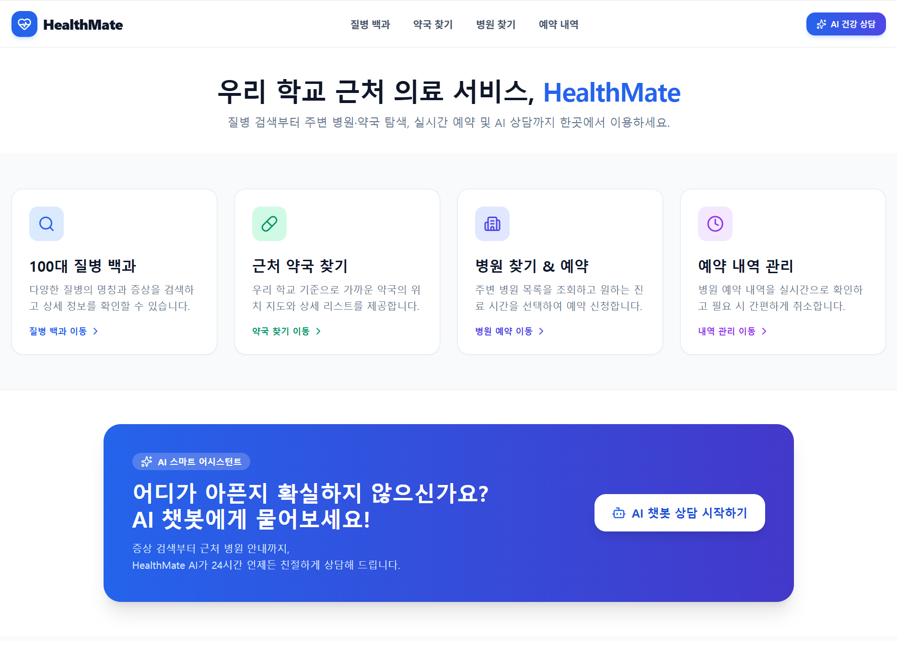
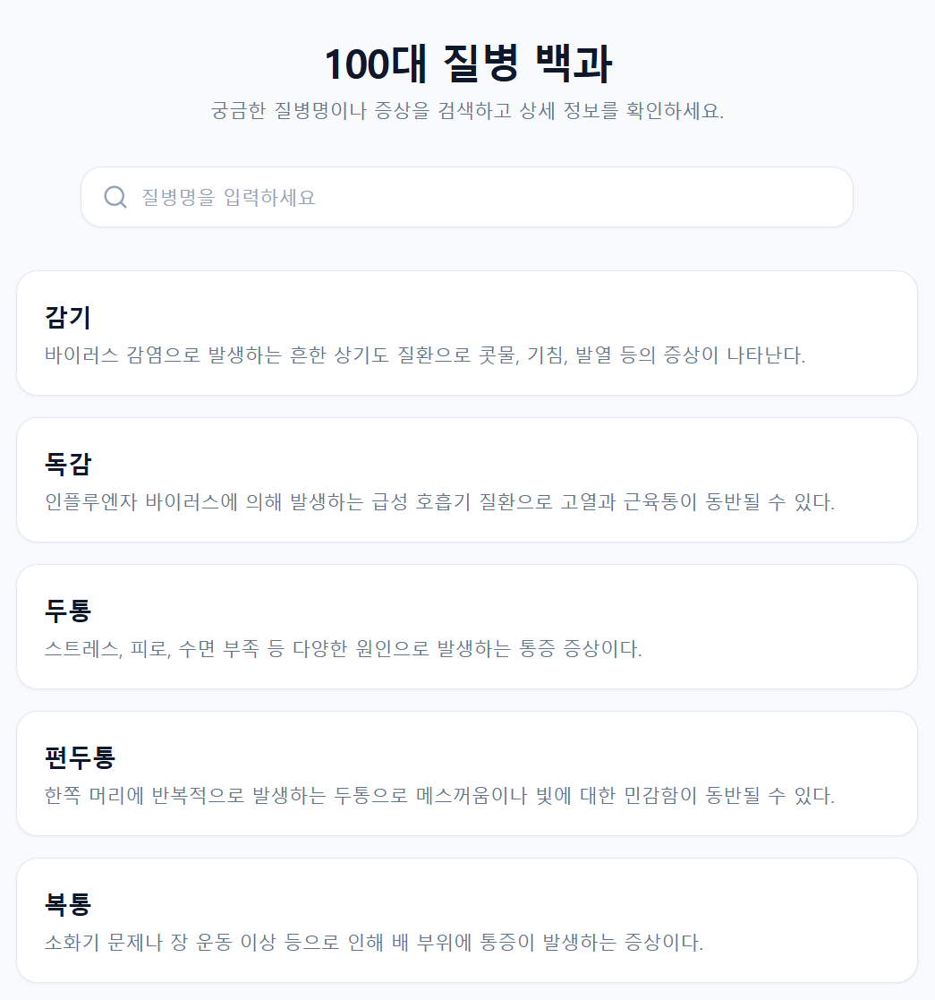
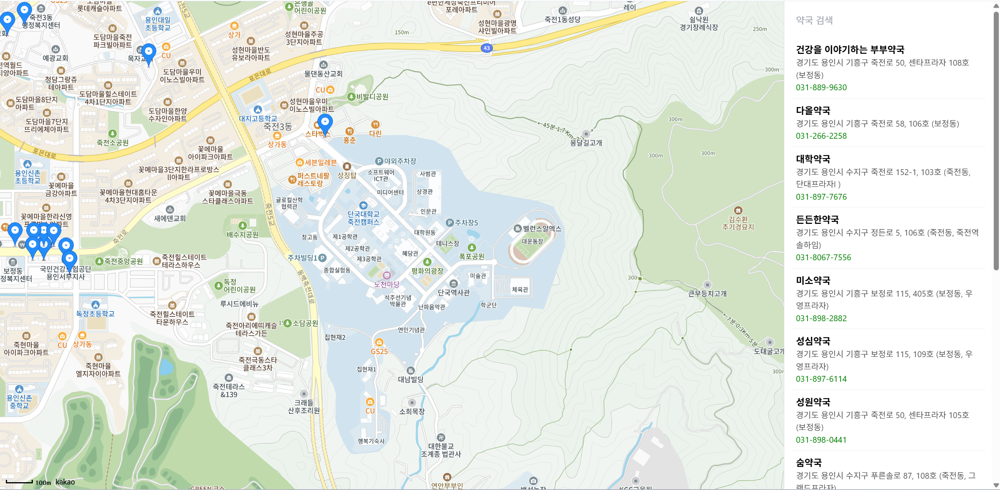
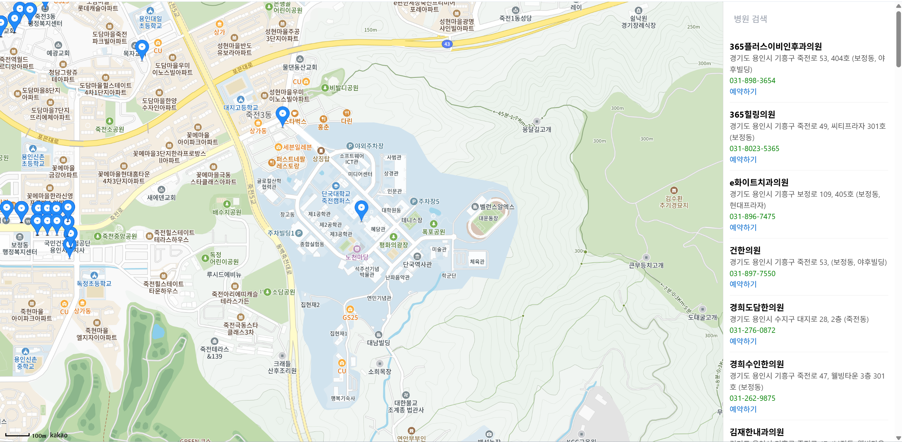
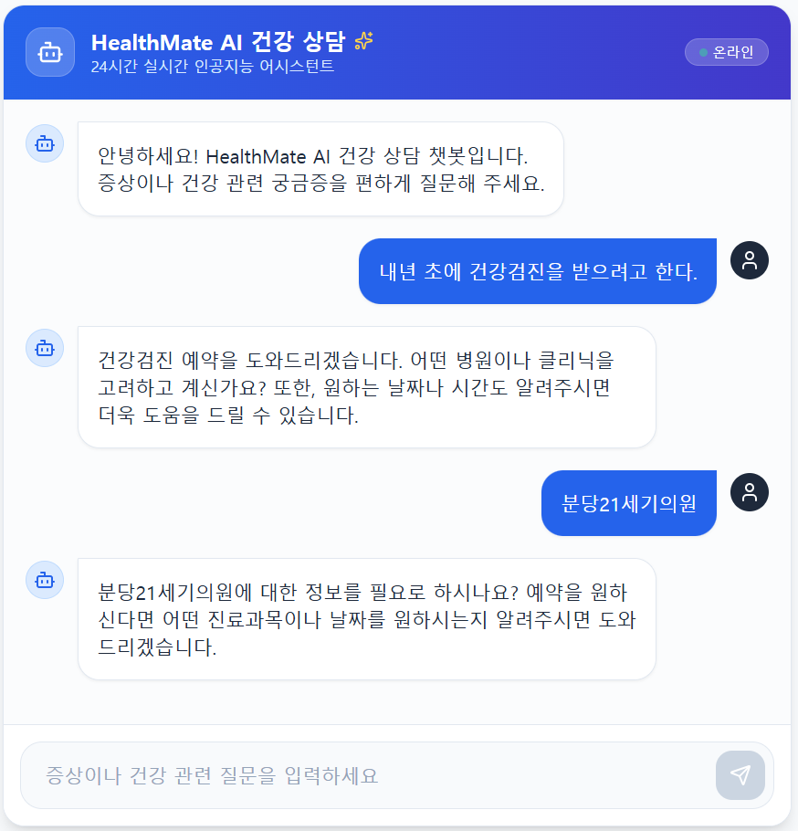

# HealthMate
> 통합 헬스케어 웹 플랫폼

HealthMate는 100가지 주요 질환 정보, 위치 기반 약국 및 병원 위치 조회, GPT-4o mini 기반 AI 건강 상담 챗봇, 그리고 예약 관리 기능을 제공하는 통합 헬스케어 웹 애플리케이션입니다.

## 제출 서류 및 영상 링크

* 졸업작품 포스터: [졸업작품_포스터.pdf](./졸업작품_포스터.pdf)
* 프로젝트 결과 보고서: [프로젝트_결과_보고서.pdf](./프로젝트_결과_보고서.pdf)
* 시연 영상 링크: https://youtu.be/VJLzTW_9RYw

## 기술 스택

### Frontend
- Framework / Library: React.js, HTML5, CSS3, JavaScript
- API: Kakao Maps API

### Backend & Database
- Framework: Python, FastAPI / Uvicorn
- AI Model: OpenAI API (GPT-4o mini)
- Database: SQLite

## 구현 결과

### 홈페이지 화면

### 질병 정보

### 약국 위치 조회

### 병원 위치 조회

### 진료 예약

### AI 챗봇

